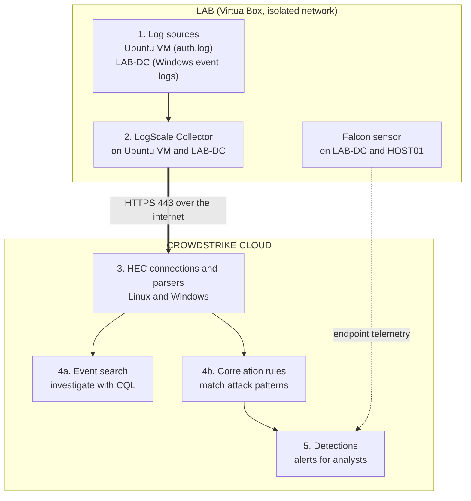

# SIEM Detection Lab: CrowdStrike Falcon Next-Gen SIEM

A proof of concept that takes logs from a Linux host and a small Windows domain into **CrowdStrike Falcon Next-Gen SIEM**, parses them, and turns them into **MITRE ATT&CK-mapped detections** validated with simulated attacks in an isolated lab.

> **Status:** Linux and Windows pipelines are working. Two detections are validated, one is in testing, and more are planned.

## Architecture

Read it top to bottom: logs are collected in the lab, sent over HTTPS to the cloud, parsed, then searched or matched by rules to produce detections. The dashed line is native sensor telemetry. All traffic is outbound only.

## Lab

| Machine | OS and role | Resources | Agents |
|---|---|---|---|
| **Ubuntu VM** | Ubuntu Server, Linux log source | 1 vCPU, 2 GB | LogScale Collector |
| **LAB-DC** | Windows Server 2022 Core, domain controller for `poclab.local` | 2 GB | Falcon sensor, LogScale Collector |
| **HOST01** | Windows Server 2022 Desktop Experience, domain member | 2 GB | Falcon sensor |

All VMs run on a single 8 GB laptop in VirtualBox, with the Windows pair and the Ubuntu VM run at different times to fit memory. The Windows VMs share an internal network (`10.10.10.0/24`) for domain traffic and use a NAT adapter for outbound HTTPS only. The lab is isolated from production, and attack simulation is limited to benign tests against dedicated lab accounts.

## Components

| Component | Role |
|---|---|
| **LogScale Collector** | Reads local logs (`auth.log`, Windows event logs) and forwards them over TLS. Collects only; does not detect. |
| **Fleet Management** | Enrolls collectors and pushes their config from the console. |
| **HEC data connections** | Cloud ingest points, one for Linux and one for Windows, each with its own URL, key, parser, and tag. |
| **Parsers** | Turn raw lines into fields (`windows.EventID`, `user.target.name`, `source.address`). |
| **Falcon sensor** | Native endpoint telemetry, stored separately (`#repo=base_sensor`). |
| **Correlation rules** | Scheduled searches that raise detections when a pattern matches. |

## Detections

| Detection | Source | MITRE | Status |
|---|---|---|---|
| [SSH brute force](detections/ssh_bruteforce.md) | Linux `auth.log` | T1110 | Done |
| [Password brute force](detections/password_bruteforce.md) | Windows 4771 / 4625 | T1110.001 | Done |
| [Password spraying](detections/password_spraying.md) | Windows 4771 / 4625 | T1110.003 | Built, testing |
| Account created, then added to a privileged group | Windows 4720 + 4728 / 4732 / 4756 | T1136, T1098 | Planned |
| Audit policy changed | Windows 4719 | T1562.002 | Planned |

## Documentation

- [Architecture](architecture.md)
- [Linux collector setup and detection](linux_collector_setup.md)
- [Windows DC and host setup](windows_dc_host_setup.md)
- [Windows collector setup](windows_collector_setup.md)
- [Troubleshooting log](troubleshooting.md)

## Troubleshooting highlights

- **Linux collector `permission denied`:** the collector's service account wasn't in the `adm` group that owns `auth.log`.
- **Windows connection idle at 0 B:** the config was created but never assigned to the collector host.
- **Windows query matched nothing:** the parser's field names differ from the defaults, and failed logons log 4771 (Kerberos) or 4625 (NTLM) depending on protocol.

## Results

| Metric | Value |
|---|---|
| Log sources onboarded | [N] |
| Detections validated | [N] |
| Measured ingest | [X] MB/day per source |
| Event to detection time | about 3 minutes (schedule-dependent) |

## Roadmap

- [x] Linux collector pipeline and SSH detection
- [x] Windows domain, collector, and sensors
- [x] Windows brute-force detection
- [ ] Finish password spraying, then add the group-change and audit-policy detections
- [ ] Dashboard: failed logons, top sources, detections per day
- [ ] Fusion SOAR notification workflow
- [ ] API automation (detection-to-alert scripts)
- [ ] Optional: collector on HOST01, firewall log source

## Security note

No tokens, keys, CIDs, tenant URLs, or real hostnames are stored here. Example configs use placeholders such as `<INGEST_TOKEN>`.