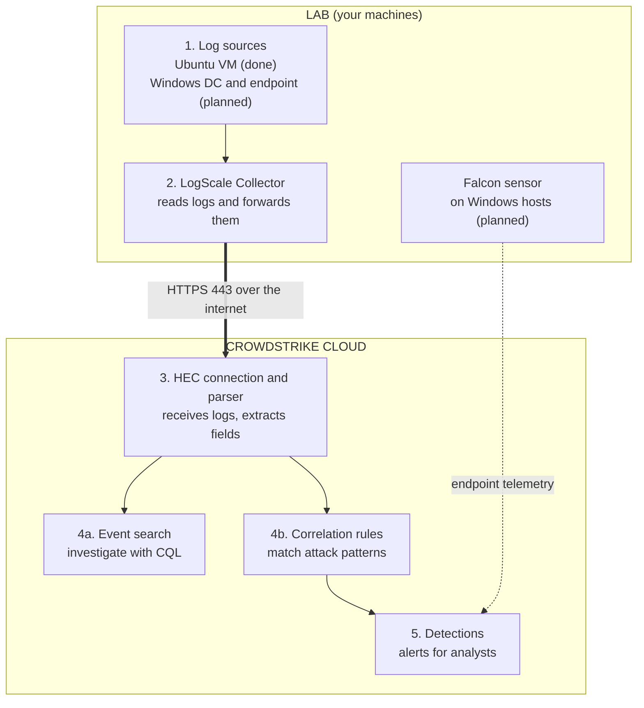

# SIEM Detection Lab: CrowdStrike Falcon Next-Gen SIEM

A small proof of concept that takes logs from lab hosts into **CrowdStrike Falcon Next-Gen SIEM**, parses them, and turns them into **MITRE ATT&CK-mapped detections** validated with simulated attacks.

> **Status:** Linux pipeline and first detection complete. Windows phase planned.

## Architecture

Read it top to bottom: logs are collected in the lab, sent over HTTPS to the cloud, parsed, then searched or matched by rules to produce detections. The dashed line is native sensor telemetry (planned). All traffic is outbound only.

## Components

| Component | Role |
|---|---|
| **LogScale Collector** | Agent on the host that reads local logs and forwards them over TLS. Collects only; does not detect. |
| **Fleet Management** | Enrolls collectors and pushes their config from the console. |
| **HEC data connection** | Cloud receiving point: provides the ingest URL and key, assigns the parser, and tags events. |
| **Parser** | Turns raw lines into fields (user, source IP, outcome, timestamp). |
| **Correlation rules** | Scheduled searches that raise detections when a pattern matches. |
| **Falcon sensor** | Endpoint agent with native behavioral telemetry. Separate from the collector. *(Windows phase)* |

## Lab

| Machine | Resources | Role |
|---|---|---|
| Ubuntu Server (laptop) | 1 vCPU, 2 GB, 20 GB | Linux log source + collector |
| Windows Server 2022 (planned) | 2 vCPU, 4 GB, 50 GB | Domain controller, collector, sensor |
| Windows 10 (planned) | 2 vCPU, 4 GB, 60 GB | Domain-joined endpoint, sensor |

Isolated from production. Simulations are limited to benign tests (failed logins, account changes).

## Detections

| Detection | Pattern | MITRE | Status |
|---|---|---|---|
| SSH brute force | Repeated `Failed password` from one IP | T1110 | Done |
| Username enumeration | Many `Invalid user` names from one IP | T1087, T1110 | Planned |
| Success after failures | `Accepted password` after repeated failures | T1078 | Planned |
| Sudo / privilege escalation | `sudo` use and failures | T1548 | Planned |
| New account or group change | `useradd`, `usermod` | T1136 | Planned |

## Troubleshooting highlight

The collector logged `permission denied` on `auth.log` because its service account wasn't in the `adm` group. Adding it and restarting the service fixed it.

## Results

| Metric | Value |
|---|---|
| Log sources onboarded | [N] |
| Detections tested | [N] |
| Measured ingest | [X] MB/day |

## Roadmap

- [ ] More Linux detections and a dashboard
- [ ] Fusion SOAR notification workflow
- [ ] Windows DC and endpoint, with identity and endpoint correlation
- [ ] API automation (detection-to-alert scripts)

## Security note

No tokens, keys, tenant URLs, or real hostnames are stored here. Example configs use placeholders such as `<INGEST_TOKEN>`.
